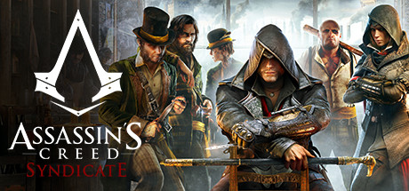

**Assassin's Creed Syndicate follows twins Jacob and Evie Frye reclaiming Victorian London's gangs and landmarks from Templar control. Features a grappling hook for traversal, horse-drawn carriage chases, and a fresh dual-protagonist story.**

---

## 📖 About

Assassin's Creed Syndicate follows twins Jacob and Evie Frye reclaiming Victorian London's gangs and landmarks from Templar control. Features a grappling hook for traversal, horse-drawn carriage chases, and a fresh dual-protagonist story.

## ⚠️ Problems Without Trainer

| Problem | Status |
|---------|--------|
| **Gang Territory Grind** — Liberating all London boroughs requires defeating many Gang Leaders | ✅ Solved |
| **Collectible Density** — Music boxes, letters, and chests across an enormous London map | ✅ Solved |
| **Carriage Chase Difficulty** — Some chase sequences have very strict timing windows | ✅ Solved |
| **Evie vs Jacob Balance** — Some missions restricted to one twin limit player freedom | ✅ Solved |

## ✅ Solution

The **Assassin's Creed Syndicate Trainer** solves all these issues by giving you complete control over the game.

## 🎯 Full Feature List

- Unlimited Resources
- God Mode / Invincibility
- Instant Skill Cooldown
- One-Hit Kill
- Freeze Game Timer
- Unlock All Items & Achievements
- Custom Speed Multiplier
- Save State Anywhere

## 🚀 Quick Start

1. **Disable Windows Defender** temporarily (trainer may trigger false positive)
2. Download the trainer from the button above
3. Launch Assassin's Creed Syndicate
4. Run the trainer as Administrator
5. Activate desired cheats with hotkeys

## 💎 Free vs Paid

| Feature | Free | Pro |
|---------|------|-----|
| Basic God Mode | ✅ | ✅ |
| Unlimited Resources | ✅ | ✅ |
| All Advanced Cheats | ❌ | ✅ |
| Auto-Updates | ❌ | ✅ |
| Priority Support | ❌ | ✅ |

## 💻 Requirements

- Windows 10/11 (64-bit)
- Assassin's Creed Syndicate (any version)
- .NET Framework 4.8+
- DirectX 11+

## 🍎 macOS

macOS users can use our alternative tool:

## ⚖️ Legal

This trainer is for educational and single-player use only. Use responsibly.

---

